# oma-rpg

RPG de estudo em TUI (Python e Textual) para o Omarchy, no modelo do [herdr](https://github.com/herdrdev/herdr): pomodoro, quests que você define, nível, vida, mana, seis classes com árvore de skills e uma moeda fictícia, os Bits. Janelas de borda fina em que só a janela com o foco acende na cor de destaque, painéis numerados à esquerda e tudo por teclado e por mouse, em português do Brasil e nas cores do tema ativo do Omarchy.

Um serviço de usuário (`oma-rpg.service`) guarda o timer, observa os repositórios git que você registrar e avisa pelo mako quando o pomodoro e a pausa acabam. A janela é só um cliente: fechá-la não para o pomodoro. O Claude Code entra como o Mestre da taverna: ajuda a montar as quests, mas não dá XP.

Versão 0.2.0.

## Capturas de tela

As capturas usam `--demo` (o herói yahiro, Garoto de Programa nível 7, com um ano de histórico inventado) e foram geradas pelo próprio Textual em 180x48 e em 90x30, sem captura da tela de ninguém.

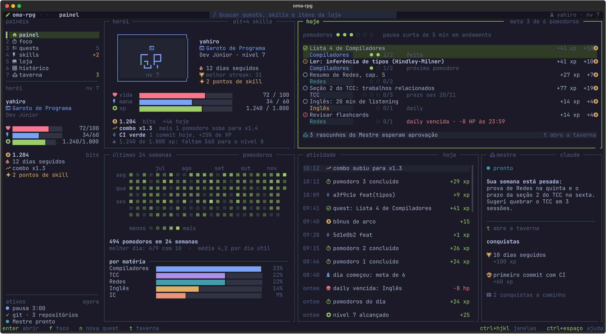

Painel. O herói com vida, mana, XP, bits, combo e a mecânica da classe; os pomodoros de hoje e a fila; o mapa das últimas 24 semanas com a divisão por matéria; a atividade do dia; o último recado do Mestre e as conquistas.

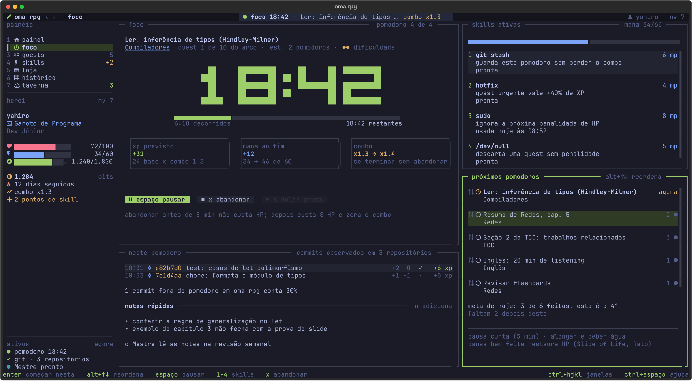

Foco. O timer grande, "pomodoro 4 de 4", o XP previsto com a conta, a mana ao fim e o combo, as skills ativas de 1 a 4, os commits feitos dentro do pomodoro, as notas rápidas e a fila, que reordena com `alt+↑↓` ou arrastando.

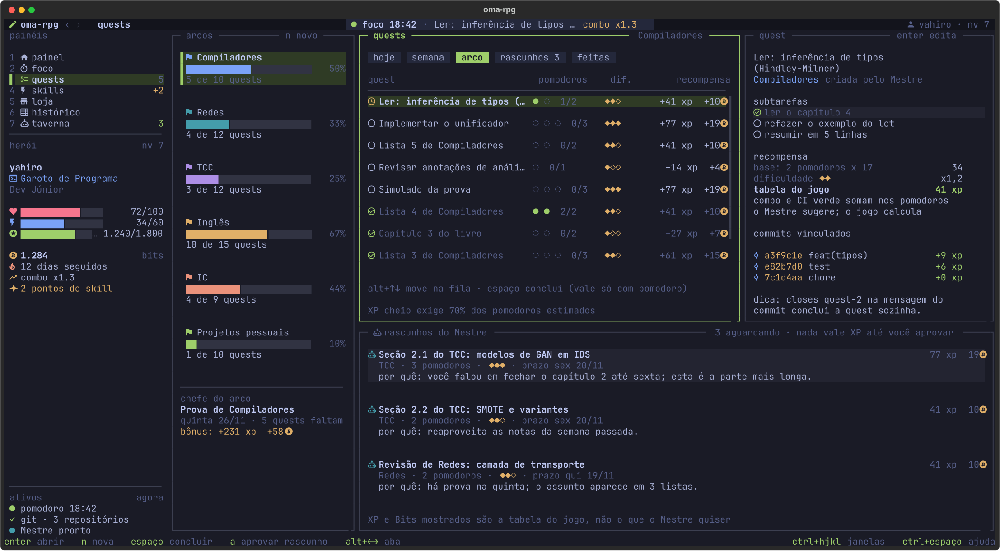

Quests. Os arcos com o chefe e o bônus; a tabela com pomodoros, dificuldade e recompensa nas abas hoje, semana, arco, rascunhos e feitas; o detalhe com a conta do XP; os rascunhos do Mestre com a recompensa que o jogo calculou.

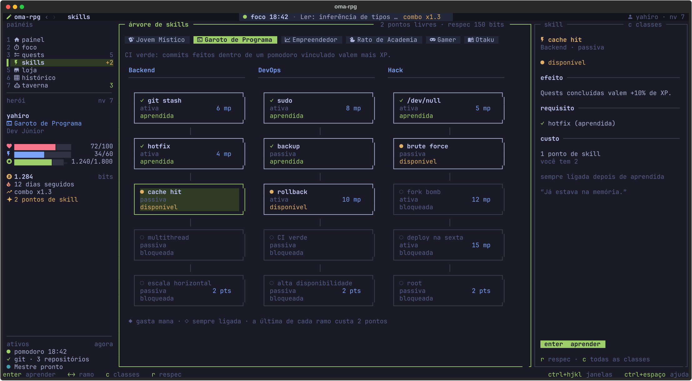 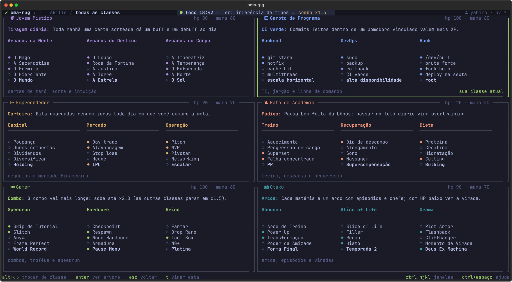

Skills (3 ramos de 5, ativas gastam mana, a última de cada ramo custa 2 pontos) e as seis classes lado a lado.

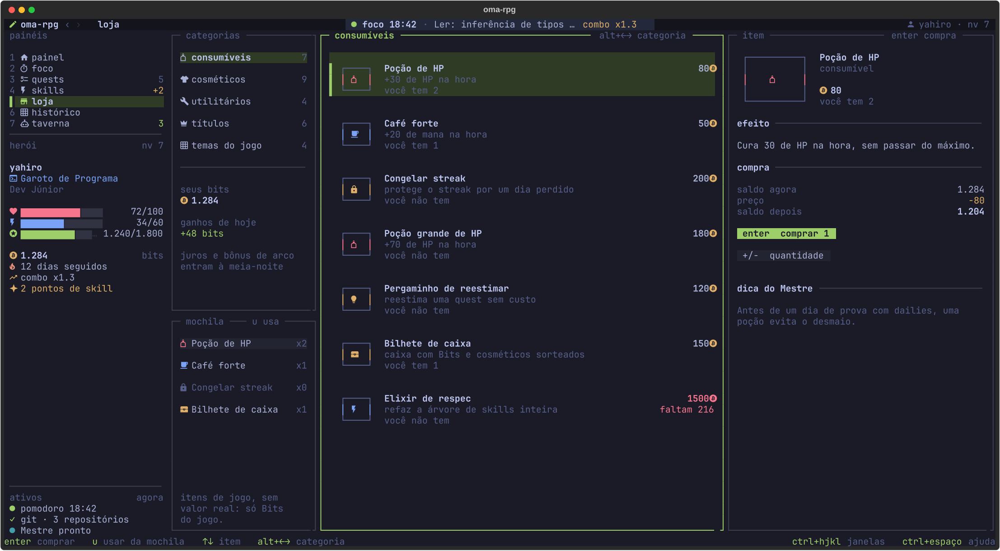 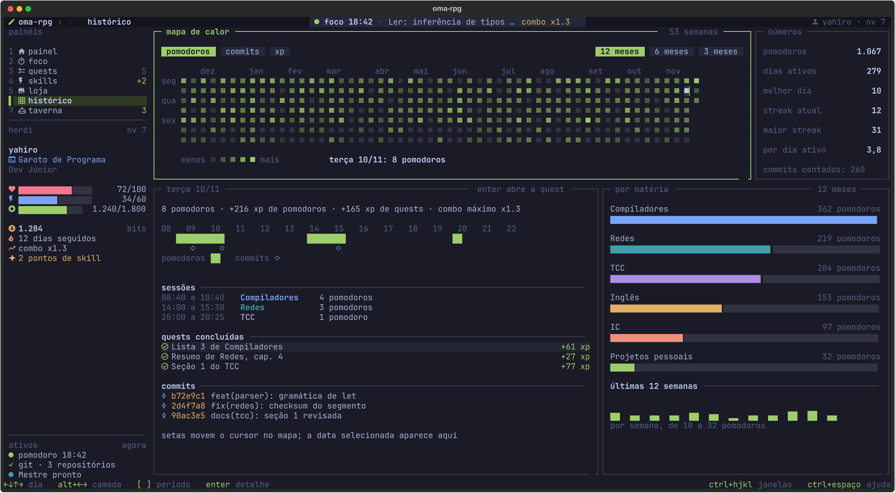

Loja (consumíveis, cosméticos, utilitários, títulos e temas do mapa) e histórico (53 semanas, camadas de pomodoros, commits e XP, o detalhe do dia e a divisão por matéria).

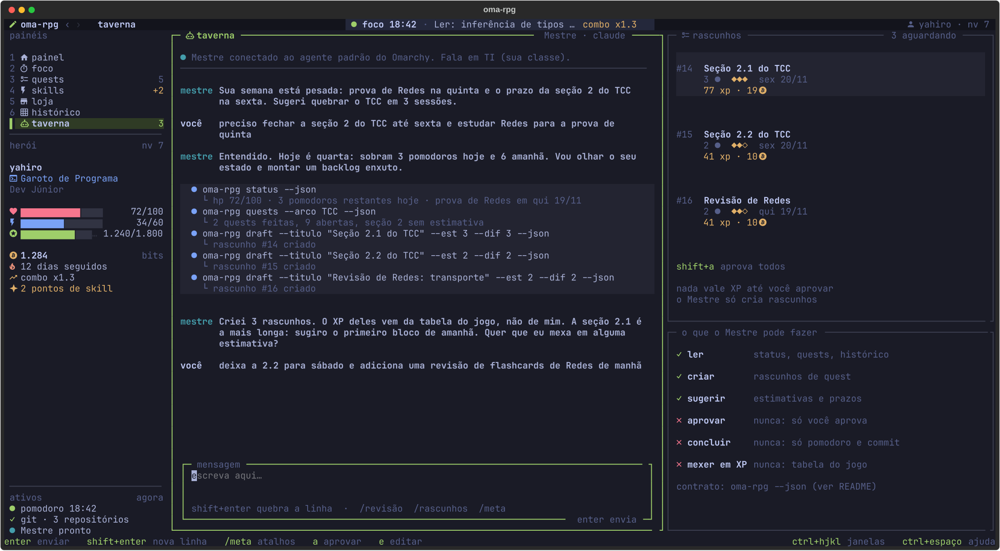

Taverna. A conversa com o Claude Code, as chamadas que ele fez ao CLI, os rascunhos esperando aprovação e o que ele pode e não pode fazer.

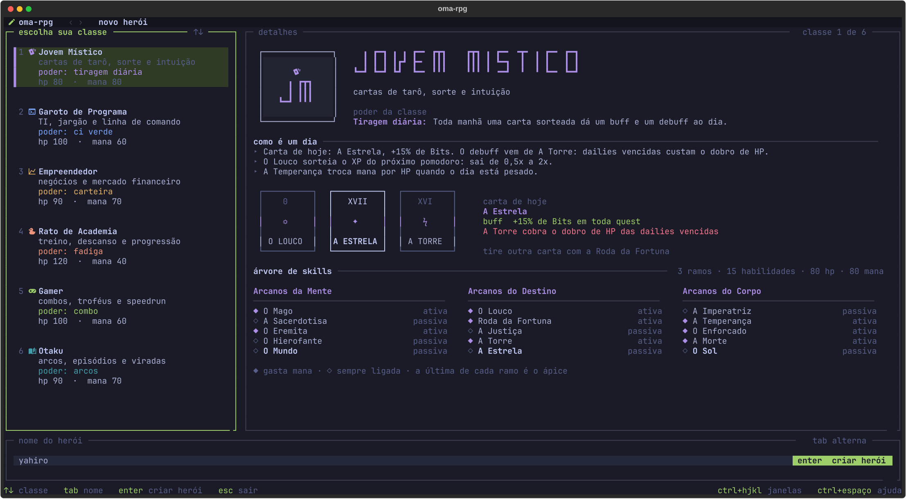 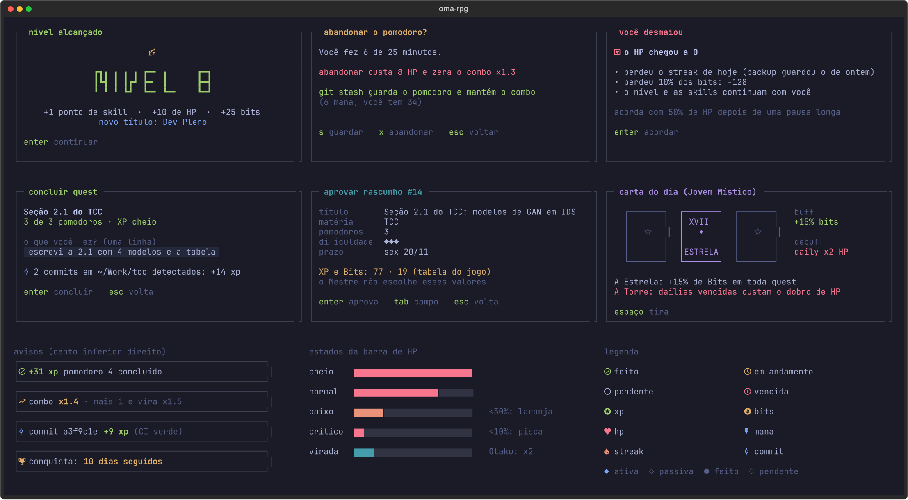

Criação de personagem (com as cartas do tarô do Jovem Místico) e os diálogos: nível, abandonar, desmaio, concluir quest, aprovar rascunho, carta do dia, os avisos, os estados da barra de HP e a legenda.

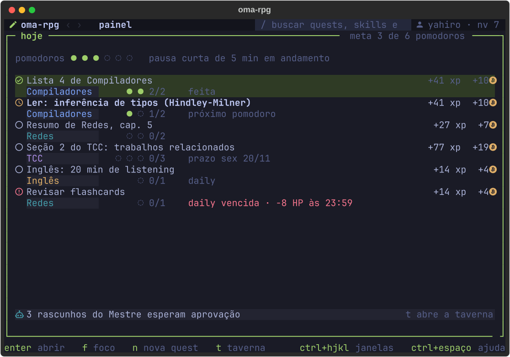

Abaixo de 120 colunas fica uma janela por vez, na tela toda; `Ctrl+setas` trocam pela mesma tabela. Mais capturas em [docs/img](docs/img): `busca`, `teclas`, `abertura`, `foco-90x30` e `quests-90x30`.

## O jogo

- **Pomodoro e commit dão XP.** Pomodoro concluído: 24 de base × combo × bônus das skills. Commit dentro de um pomodoro vinculado vale 100%, solto vale 30%.
- **Quest**: `xp = round(17 × est × mult_dif)` (fácil 0,8, média 1,2, difícil 1,5) e `bits = round(xp / 4)`. Ex.: média de 2 pomodoros, 41 xp e 10 bits. Só vale com pomodoro feito nela, e o XP cheio exige 70% dos pomodoros estimados.
- **Combo**: sobe 0,1 a cada pomodoro seguido no dia, de x1.0 a x1.5 (x2.0 no Gamer), e zera se você abandonar.
- **Vida**: abandonar depois de 5 minutos custa 8 HP; daily vencida custa 8 HP à meia-noite. Com 0 você desmaia: perde 10% dos bits e o streak de hoje, e acorda com 50% de HP depois de uma pausa longa.
- **Mana**: pausa respeitada dá +6 (+12 na longa); as skills ativas gastam.
- **Teto diário**: do 11º pomodoro em diante é overtraining e o XP cai pela metade.
- **Bits**: moeda do jogo, só para a loja. Não vale nada fora dele.
- **Classes**: Jovem Místico (carta do dia), Garoto de Programa (CI verde), Empreendedor (juros), Rato de Academia (fadiga), Gamer (combo até x2.0) e Otaku (virada com HP baixo). Dá para trocar depois, perdendo os pontos gastos.

Os números que o design deixou em aberto (teto diário, curva de nível, XP de commit, skills das outras classes) estão em `src/oma_rpg/balanceamento.toml` e `conteudo.toml`, com o motivo de cada um em [DECISOES.md](DECISOES.md). Para mudar, copie as chaves para `~/.config/oma-rpg/balanceamento.toml` e reinicie o serviço.

## Instalar

Dependências: `python` (3.13 ou mais novo) e `python-textual`. Opcionais: `git` (repositórios observados), `libnotify` (avisos pelo mako), o Claude Code (taverna) e `xdg-terminal-exec` (abrir pelo menu). Os ícones usam Nerd Font (o Omarchy já vem com ela); `OMA_RPG_ICONES=simples` troca por caracteres comuns.

```bash
cd packaging
./empacotar.sh                     # gera o pacote em packaging/ (faça commit antes)
sudo pacman -U oma-rpg-0.2.0-1-any.pkg.tar.zst
systemctl --user enable --now oma-rpg.service
oma-rpg
```

O serviço:

```bash
systemctl --user enable --now oma-rpg.service    # liga agora e em todo login
systemctl --user disable --now oma-rpg.service   # desliga
systemctl --user status oma-rpg.service
journalctl --user -u oma-rpg.service             # só avisos, sem texto de quest, nota ou taverna
```

Sem instalar: `uv run oma-rpg` na raiz do repositório, ou `uv run oma-rpg --demo`.

Na primeira vez abre a criação de personagem. Para os commits valerem XP, registre os repositórios clicando em "git · N repositórios" na coluna da esquerda (pasta e, se quiser, a matéria: um repositório com matéria só vale 100% em pomodoro de quest daquela matéria).

## Na barra do omarchy-shell

O app não mexe no Hyprland nem nos plugins do shell. Para um módulo de barra mostrar o timer, ele pode rodar a cada poucos segundos:

```bash
oma-rpg status            # uma linha: "● 18:42 x1.3" no foco, "☕ 3:12" na pausa, "nv 7 · ♥ 72 · 3/6" parado
oma-rpg status --barra    # JSON: {"text": ..., "tooltip": ..., "class": "foco|pausa|pausado|desmaio|parado", "percentage": ...}
```

O `status` lê o banco direto (só leitura), sem acordar o serviço, e custa um processo Python curto. No omarchy-shell, um plugin de barra em QML (como o `BarWidget.qml` do omarchy-manager) pode chamar esse comando com um `Process` e um `Timer` de 5 s, e abrir a TUI com `omarchy-launch-tui oma-rpg` no clique.

## O Mestre (Claude Code)

A taverna abre o `claude` com a skill `oma-rpg` e só estes comandos liberados. O agente também usa o mesmo CLI fora da taverna, sempre com `--json`:

```text
oma-rpg status --json                  herói, combo, HP, pomodoros de hoje
oma-rpg quests [--arco X] --json       quests e rascunhos
oma-rpg history --days 30 --json       pomodoros, commits e notas por dia
oma-rpg draft --titulo "..." --materia "..." --est 2 --dif 2 [--arco X] [--prazo 2026-11-27] [--porque "..."] --json
oma-rpg editar ID [--est N] [--dif N] ... --json   só rascunho ainda não aprovado
oma-rpg pastas --json                  pastas de estudo liberadas para leitura
oma-rpg ls PASTA --json                lista pasta liberada (ou pergunta na taverna)
oma-rpg ver ARQUIVO [--texto] --json   lê arquivo em pasta liberada (PDF grande: só metadados sem --texto)
```

Resposta: `{"ok": true, "dados": ...}` ou `{"ok": false, "erro": "..."}`. Um rascunho volta com `id`, `xp_previsto` e `bits_previstos`.

| O Mestre pode | O Mestre não pode |
|---|---|
| ler status, quests e histórico | aprovar rascunho |
| criar e editar rascunhos | concluir quest, começar pomodoro, comprar, aprender skill |
| ler pastas de estudo liberadas (`P` na taverna) | alterar XP, Bits, HP, nível, skills ou a lista de pastas |
| sugerir estimativa e dificuldade | escrever arquivos, rodar shell genérico ou delegar a subagentes |

O XP só nasce de pomodoro concluído no relógio do serviço e de commit visto no git. O CLI não tem nenhum subcomando que aprove, conclua ou dê XP, o serviço recusa esses pedidos de quem não tem a chave de jogador (só a interface tem), e commit com `Co-Authored-By: Claude` vale 0 xp. Detalhes em [DECISOES.md](DECISOES.md), seção 2.

A skill revisada está em [skill/oma-rpg/SKILL.md](skill/oma-rpg/SKILL.md).

## Teclas e mouse

| Tecla | O que faz |
|---|---|
| `Ctrl+←` `↓` `↑` `→` ou `Ctrl+h` `j` `k` `l` | muda de janela |
| `←` `↓` `↑` `→` ou `h` `j` `k` `l` | anda dentro da janela |
| `Alt+←` `→` | troca de aba, camada ou categoria |
| `Alt+↑` `↓` | move ou reordena o item (fila, quests) |
| `Alt+1` … `Alt+7` | vai direto para o painel |
| `Tab` `Shift+Tab` | próxima janela |
| `/` | busca quests, skills e itens |
| `Ctrl+Espaço` ou `F1` | teclas da janela em foco |
| `?` | ajuda completa |
| `q` | sai (o serviço e o pomodoro continuam) |

Por tela: painel `enter` abre, `f` foco, `n` nova quest, `t` taverna · foco `espaço` pausa ou começa, `1`-`4` skills, `x` abandona, `s` pula a pausa, `n` anota · quests `enter` edita, `n` nova, `espaço` conclui, `a` aprova rascunho, `d` descarta, `+` fila de hoje, `f` foco nela, `Shift+a` aprova todos · skills `enter` aprende, `r` respec, `c` classes · classes `enter` árvore, `t` vira esta classe, `esc` volta · loja `enter` compra ou equipa, `u` usa, `+` `-` quantidade · histórico `[` `]` período, `enter` detalhe · taverna `enter` envia, `Shift+Enter` quebra a linha, `p` pastas liberadas, `/revisão` `/rascunhos` `/meta`.

O rodapé mostra até 5 teclas da janela em foco e o lembrete `ctrl+hjkl janelas · ctrl+espaço ajuda`; cada tecla do rodapé é clicável.

Mouse: clique escolhe e dá foco à janela, roda rola, clique duplo abre (e aprende a skill na árvore), arrastar reordena a fila e as quests, clique nas abas e nos ativos.

### Tabela do Ctrl+setas

"·" quer dizer que o foco fica onde está. O topo fica em cima de todas (de lá, `Ctrl+↓` volta para a última janela) e a coluna dos painéis à esquerda da primeira coluna (de lá, `Ctrl+→` vai para a janela de entrada da página).

| Página | Saindo de | ← | → | ↑ | ↓ |
|---|---|---|---|---|---|
| painel | herói | painéis | hoje | topo | últimas 24 semanas |
| painel | hoje | herói | · | topo | atividade |
| painel | últimas 24 semanas | painéis | atividade | herói | · |
| painel | atividade | últimas 24 semanas | mestre | hoje | · |
| painel | mestre | atividade | · | hoje | · |
| foco | foco | painéis | skills ativas | topo | neste pomodoro |
| foco | neste pomodoro | painéis | próximos pomodoros | foco | · |
| foco | skills ativas | foco | · | topo | próximos pomodoros |
| foco | próximos pomodoros | neste pomodoro | · | skills ativas | · |
| quests | arcos | painéis | quests | topo | · |
| quests | quests | arcos | quest | topo | rascunhos |
| quests | quest | quests | · | topo | rascunhos |
| quests | rascunhos | arcos | · | quests | · |
| skills | árvore | painéis | skill | topo | · |
| skills | skill | árvore | · | topo | · |
| classes | Jovem Místico | · | Garoto de Programa | topo | Empreendedor |
| classes | Garoto de Programa | Jovem Místico | · | topo | Rato de Academia |
| classes | Empreendedor | · | Rato de Academia | Jovem Místico | Gamer |
| classes | Rato de Academia | Empreendedor | · | Garoto de Programa | Otaku |
| classes | Gamer | · | Otaku | Empreendedor | · |
| classes | Otaku | Gamer | · | Rato de Academia | · |
| loja | categorias | painéis | itens | topo | mochila |
| loja | mochila | painéis | itens | categorias | · |
| loja | itens | categorias | item | topo | · |
| loja | item | itens | · | topo | · |
| histórico | mapa de calor | painéis | números | topo | dia |
| histórico | números | mapa de calor | · | topo | por matéria |
| histórico | dia | painéis | por matéria | mapa de calor | · |
| histórico | por matéria | dia | · | números | · |
| taverna | conversa | painéis | rascunhos | topo | · |
| taverna | rascunhos | conversa | · | topo | o que o Mestre pode |
| taverna | o que o Mestre pode | conversa | · | rascunhos | · |

Em alguns terminais `Ctrl+j` chega como Enter e `Ctrl+h` como Backspace: use `Ctrl` com as setas. Dentro do herdr, `Ctrl+Espaço` é o prefixo dele: use `F1`.

## Segurança e privacidade

- Sem rede e sem telemetria. O git roda só com metadados locais e sem shell; o `claude` da taverna é o do usuário, chamado com a lista de argumentos e a mensagem pela entrada padrão.
- Nada vindo de dado vira comando: título de quest, mensagem de commit e resposta do Mestre são texto (escapado antes de virar marcação na tela ou no mako).
- Entradas validadas no motor: textos com tamanho máximo e sem caracteres de controle, números com faixa, datas no formato AAAA-MM-DD, caminho de repositório resolvido e conferido.
- Banco, socket e chave são 0600, em pastas 0700. O socket confere o usuário do outro lado (`SO_PEERCRED`). O log fica em nível de aviso, sem texto de quest, nota ou taverna. O contexto da interface (`estado.json`, em `$XDG_RUNTIME_DIR`) só guarda posição.

## Memória

Medido com Textual 8.2.8, lendo o `VmRSS` do processo:

| Processo | Situação | Python 3.14.8 | Python 3.13.18 | Meta |
|---|---|---|---|---|
| interface (`--demo`, pty 180x48) | em repouso | 51,6 MB | 49,9 MB | até 55 MB |
| interface (`--demo`, pty 180x48) | depois de 4 rodadas pelos 7 painéis, classes, abas, camadas, busca, ajuda e taverna | 62,8 MB | 60,9 MB | até 85 MB |
| serviço | um ano de histórico e um repositório observado, em repouso | 25,0 MB | 22,6 MB | até 40 MB |

O teste `tests/integration/test_memoria.py` falha se os números passarem das metas.

## Desenvolvimento e testes

```bash
uv sync --extra dev
uv run pytest                       # a suíte inteira
uv run oma-rpg --demo
PYTHONPATH=src python tests/manual/capturas.py   # refaz as capturas de docs/img
```

Os testes cobrem as fórmulas do design, combo, HP, mana, desmaio, overtraining, virada do dia, persistência (o serviço cai no meio do pomodoro e volta), o serviço pelo socket com relógio falso (25 minutos passam num `avancar`), o git num repositório temporário (solto, vinculado, CI verde, `closes quest-N`, autor de fora, inotify), a garantia de que a skill e o CLI não dão XP, o pilot do Textual em cada tela e em cada linha da tabela do Ctrl+setas, a interface com o serviço de verdade e a memória.

## Licença

MIT, ver [LICENSE](LICENSE).
